# Font drawing: smoothing, hinting, shaping and sub-pixel placement, measured

Date: 2026-11-01. Status: research; the six levers are flags of the desktop tool only, the app has no setting yet. Task: [issue #122](https://github.com/juev/perigee/issues/122).

The issue plans six reading settings for how the glyphs are drawn. Before they are added, this file answers three questions: does each lever reach the font, does it move lines and pages, and what does it look like.

## The setting

`engine/tools/desktop/gaps` with the flags `--antialias`, `--hinting`, `--kerning`, `--fractional`, `--monospace-scale` and `--embedded-fonts` (see its README). Without them a run is the app's behaviour: before and after the flags were added, the tool gave 158 pages at 28 px and 801 at 63 px, and byte-identical CSV and page images.

Page 1032×2000 px, render DPI 336, hyphenation on, no margins. Sizes 28 px and 63 px (18 dp on the owner's 560 dpi phone). The x-height rule of `face_size.h` is on as in the app, so a face asked at 63 px is drawn at an em of 61 to 67 px. Books: `gaps-book-ru.fb2` (897 KB of Russian prose) and, as a cross-check, `gaps-book-clean.fb2` (1 MB). Neither carries fonts or code, so `--embedded-fonts` and `--monospace-scale` were not measured: on these books they cannot change anything.

## Grey levels

Counting rule (`pgm-levels.py`): over the whole page, the text pixels are all pixels that are not white (255); the levels are the distinct 8-bit values, white included, that occur on at least 20 pixels. The threshold keeps a value met on a stray pixel or two out of the count. A monochrome page therefore has exactly two levels, white and black.

Page 3, Roboto, 63 px:

| antialias | hinting | text pixels | levels | black | grey |
| --- | --- | --- | --- | --- | --- |
| on (today) | 2 (today) | 302 981 | 255 | 206 094 | 96 887 |
| on | 1 | 302 536 | 255 | 206 573 | 95 963 |
| on | 0 | 309 528 | 255 | 205 056 | 104 472 |
| off | 2 | 251 834 | 2 | 251 834 | 0 |
| off | 0 | 258 372 | 2 | 258 372 | 0 |

The same holds for page 3 of every shipped face at 63 px (two levels off, 255 on) and for Roboto at 28 px (two off, 255 on). So `--antialias off` reaches the font, and a device test can assert "two levels with smoothing off, many with it on".

## Page count and time

Whole book, Roboto. Pages are exact; times are medians of three runs, in ms, `Render()` / drawing every page. On this machine the same run varies by about 10 % (the default at 28 px gave `Render()` from 115 to 122 ms across batches, `--kerning 3` from 125 to 150 ms), so a smaller difference is noise.

| setting | ru 28 px | ru 63 px | clean 28 px | clean 63 px |
| --- | --- | --- | --- | --- |
| today (aa on, h2, k2, f0) | 158 · 117 / 704 | 801 · 129 / 1407 | 183 · 125 / 822 | 919 · 139 / 1603 |
| antialias off | **159** · 121 / 666 | **806** · 126 / 1238 | **184** · 126 / 762 | **927** · 144 / 1426 |
| hinting 0 | 158 · 127 / 703 | 801 · 124 / 1423 | 183 · 124 / 916 | 919 · 134 / 1664 |
| hinting 1 | 158 · 117 / 725 | 801 · 132 / 1435 | 183 · 122 / 813 | 919 · 144 / 1625 |
| fractional 1 | 158 · 114 / 710 | 801 · 125 / 1399 | 183 · 123 / 795 | 919 · 145 / 1611 |
| fractional 2 | 158 · 115 / 717 | 801 · 134 / 1385 | 183 · 120 / 796 | 919 · 135 / 1609 |
| fractional 3 | 158 · 115 / 703 | 801 · 125 / 1401 | 183 · 126 / 799 | 919 · 136 / 1610 |
| kerning 3 | 158 · 125 / 677 | 801 · 136 / 1434 | 183 · 156 / 750 | 919 · 154 / 1638 |

Whether lines moved was checked beyond the page count, on the ru book, by comparing the page text (`--text`) and the line widths of the CSV with today's:

- **Smoothing off re-breaks lines** at both sizes: 1053 page-text lines differ at 28 px, 2149 at 63 px, and the page count changes. Monochrome glyphs have other advances. Across the eight faces at 63 px only Literata keeps its page count (Roboto 801→806, PT Serif 848→853, Noto Serif 846→847, PT Sans 792→793, Droid Serif 853→845, Merriweather 831→833, Comfortaa 920→928). The setting needs the relayout path with the bookmark kept, as the issue says.
- **Hinting 0 and 1 change line widths but did not move a line here**: hinting 0 changes the natural width of 461 of 6686 lines at 28 px and 1412 of 16 911 at 63 px, and the page text stays the same. Another book may re-break; the setting should take the same path.
- **Kerning 3 changes the widths of 201 lines at 28 px and 294 at 63 px**; at 63 px that moves 1188 page-text lines with the same page count.
- **Sub-pixel placement does nothing with kerning 2.** Pages 3 at 63 px with `--fractional` 1 and 3 are byte-identical to today's, and no line width changes. See the next section.

### Kerning 3 against kerning 2

Seven alternating runs each, medians in ms:

| book, size | `Render()` k2 → k3 | ratio | drawing k2 → k3 |
| --- | --- | --- | --- |
| ru 28 px | 115 → 128 | 1.11 | 718 → 656 |
| ru 63 px | 127 → 138 | 1.09 | 1383 → 1448 |
| clean 28 px | 123 → 146 | 1.19 | 803 → 754 |
| clean 63 px | 136 → 157 | 1.15 | 1628 → 1656 |

Full shaping lays these books out 9 % to 19 % slower, and drawing is the same within noise. The fivefold figure in `engine_jni.cpp` (4 s against 0.8 s, a 2.8 MB FB2 on a 2025 phone) is not reproduced here. That book and that phone were not available, so the cause is not known; a guess, not checked: light kerning already shapes every character triplet through HarfBuzz, so most of the HarfBuzz cost is paid at 2 as well. For scale, kerning 0 and 1 lay the ru book out at 28 px in 47 and 55 ms (one run each). The ligatures switch's warning about a fivefold cost should be measured on the phone before it ships.

### Sub-pixel placement needs full shaping

In the pinned crengine the placement granularity is read only in the `KERNING_MODE_HARFBUZZ` paths of measuring and drawing (`lvfntman.cpp:3119` and `:4441`, inside the blocks at `:2942` and `:4333`). With the app's kerning 2 the property is stored and ignored. Strength also turns into phases by size (`lvfntman.cpp:1604-1619`): at 63 px strength 1 gives one phase, which is the same as off.

With `--kerning 3`, three runs, medians:

| fractional | ru 28 px | ru 63 px | clean 28 px | clean 63 px |
| --- | --- | --- | --- | --- |
| 0 | 158 · 150 / 769 | 801 · 144 / 1576 | 183 · 158 / 815 | 919 · 161 / 1880 |
| 1 | 158 · 145 / 1047 | 801 · 152 / 1620 | **184** · 156 / 1243 | 919 · 166 / 1907 |
| 2 | 158 · 149 / 1775 | **804** · 140 / 1832 | **184** · 154 / 2016 | **923** · 175 / 2240 |
| 3 | 158 · 132 / 2784 | **804** · 157 / 2159 | **184** · 143 / 3214 | **923** · 163 / 2382 |

Where it takes effect it re-breaks lines (5135 of 6686 line widths and 336 page-text lines differ at 28 px with strength 1), and drawing gets slower with every phase: 3.6 times at strength 3 and 28 px. The issue plans four steps of placement independent of the ligatures switch; as the engine stands, the steps do nothing unless ligatures are on. That is a product question for the owner, not settled here.

## Contact sheets

Page 3 of the ru book, a 700×420 px window from x 0 and the first white row from y 860 down, so no line is cut at the top. Each face lays the page out on its own, so the text differs between images. The images are 1:1; click one for the same crop at 2× nearest-neighbour.

### The eight faces at 63 px, smoothing on and off (hinting 2)

| face | smoothing on (today) | smoothing off |
| --- | --- | --- |
| Roboto | [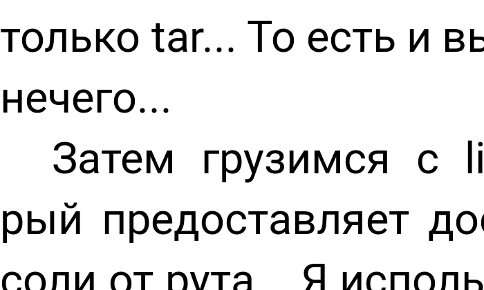](font-drawing/faces-Roboto-aa1-2x.png) | [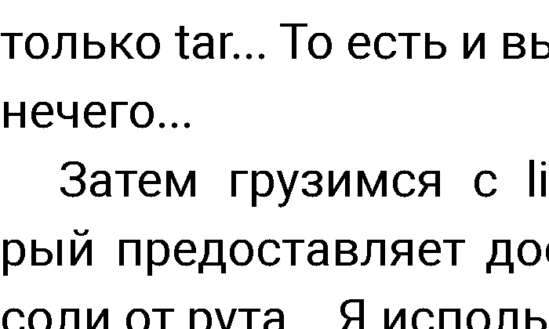](font-drawing/faces-Roboto-aa0-2x.png) |
| Literata | [](font-drawing/faces-Literata-aa1-2x.png) | [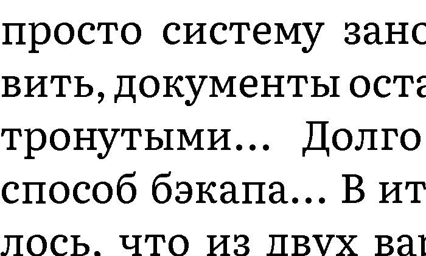](font-drawing/faces-Literata-aa0-2x.png) |
| PT Serif | [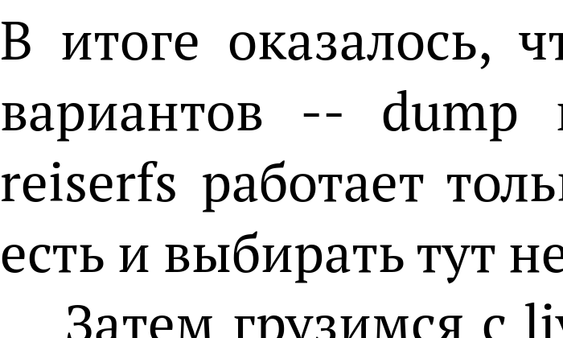](font-drawing/faces-PTSerif-aa1-2x.png) | [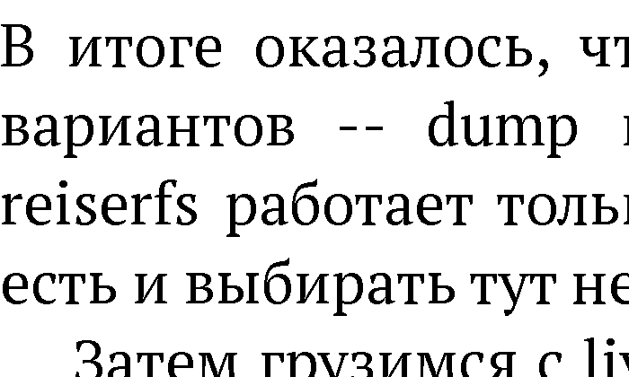](font-drawing/faces-PTSerif-aa0-2x.png) |
| Noto Serif | [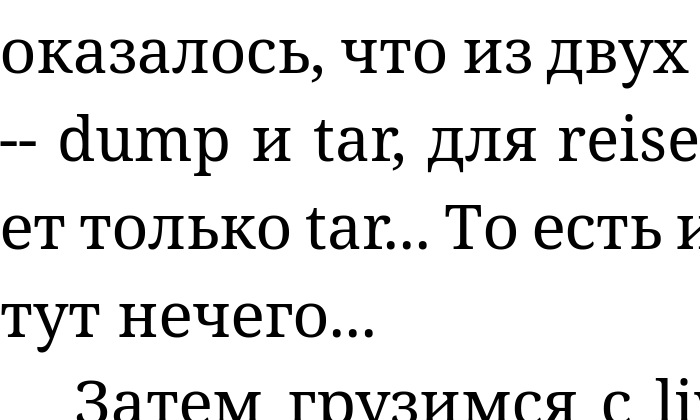](font-drawing/faces-NotoSerif-aa1-2x.png) | [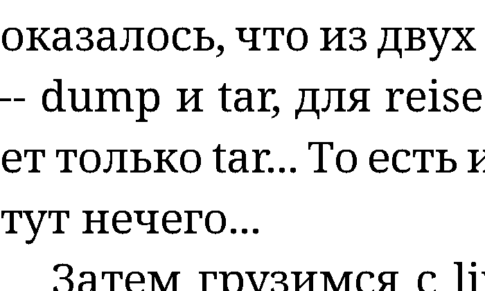](font-drawing/faces-NotoSerif-aa0-2x.png) |
| PT Sans | [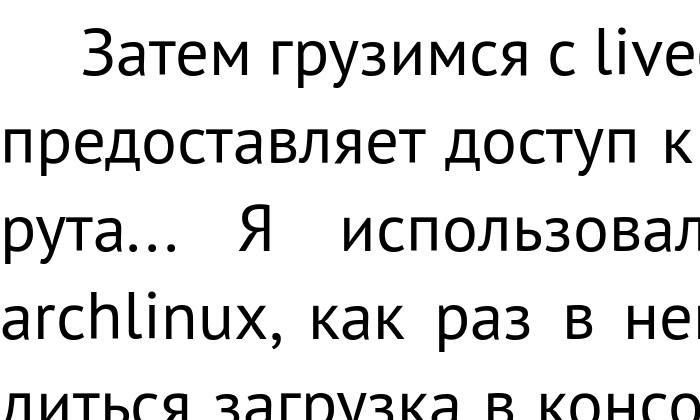](font-drawing/faces-PTSans-aa1-2x.png) | [](font-drawing/faces-PTSans-aa0-2x.png) |
| Droid Serif | [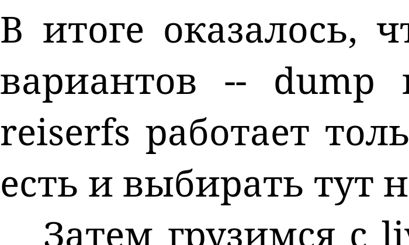](font-drawing/faces-DroidSerif-aa1-2x.png) | [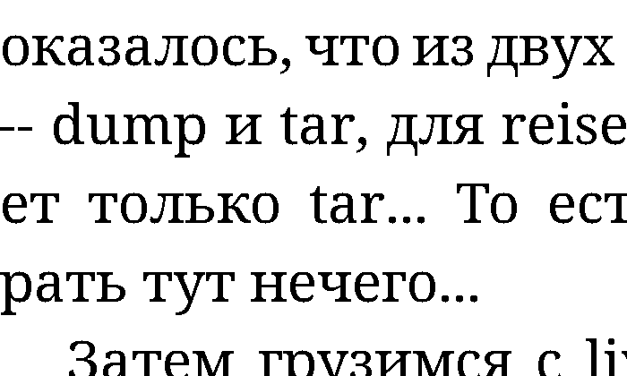](font-drawing/faces-DroidSerif-aa0-2x.png) |
| Merriweather | [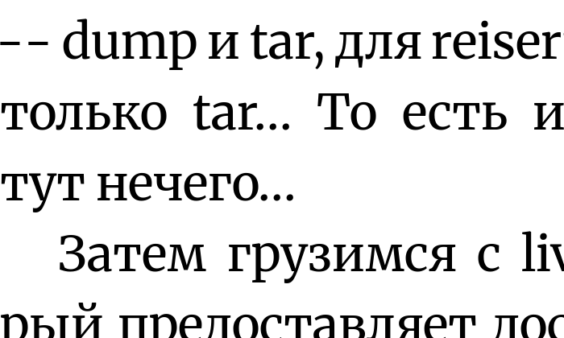](font-drawing/faces-Merriweather-aa1-2x.png) | [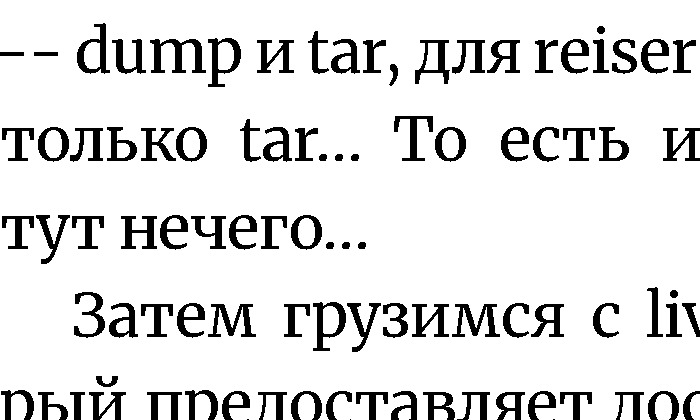](font-drawing/faces-Merriweather-aa0-2x.png) |
| Comfortaa | [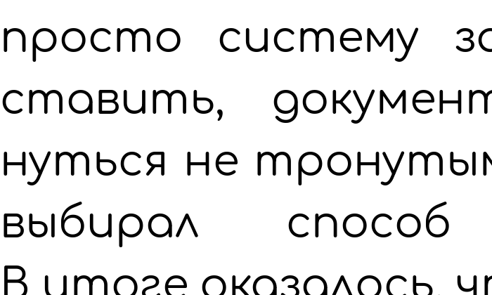](font-drawing/faces-Comfortaa-aa1-2x.png) | [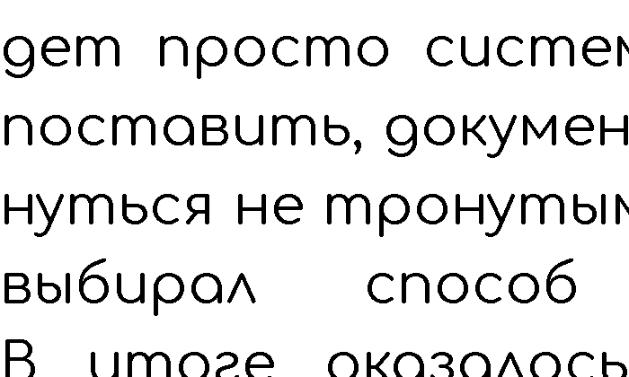](font-drawing/faces-Comfortaa-aa0-2x.png) |

### Hinting at 63 px, smoothing on

| face | hinting 0 (off) | hinting 2 (autohint, today) |
| --- | --- | --- |
| Roboto | [](font-drawing/hint-Roboto-h0-2x.png) | [](font-drawing/hint-Roboto-h2-2x.png) |
| Literata | [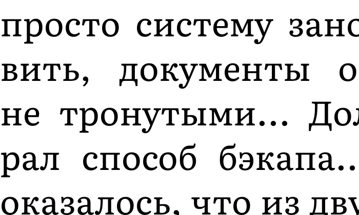](font-drawing/hint-Literata-h0-2x.png) | [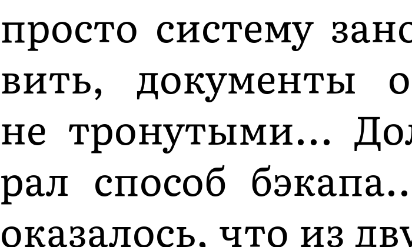](font-drawing/hint-Literata-h2-2x.png) |

### Roboto at 28 px, at 2×

Smoothing off moves the lines at this size too (159 pages against 158), so the two crops hold slightly different text.

| smoothing on (today) | smoothing off |
| --- | --- |
| 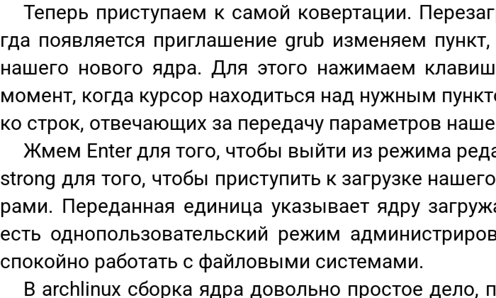 | 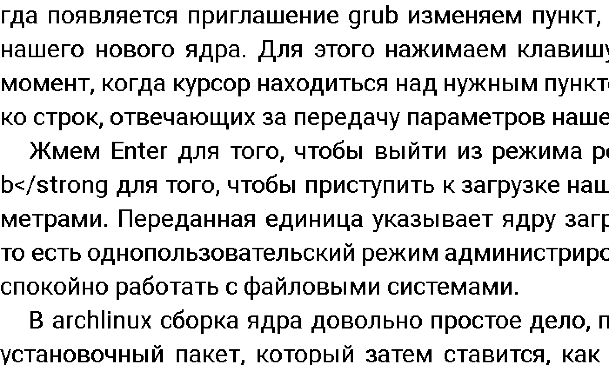 |

## Caveats

- The crops come from a desktop build at render DPI 336 and are shown on whatever screen opens this file. The owner judges on an OLED phone at 560 dpi, where a pixel is far smaller; the phone decides.
- A level count proves that antialiasing is there, not that the page looks better with it.
- The tool draws black on white only; the Day/Night colours the issue mentions are a mapping the app applies after drawing and are not shown.
- Times are from one x86 desktop with run-to-run noise of about 10 %; they rank the settings, they do not predict the phone.
- `--embedded-fonts` and `--monospace-scale` were checked only for reaching the engine (the summary line, the image names); the test books have no embedded fonts and no code.

## Reproduce

```sh
BUILD=/opt/data/cache/scratch/font-drawing-build engine/tools/desktop/build.sh
G=/opt/data/cache/scratch/font-drawing-build/cmake/gaps F=engine/src/main/assets/crengine/fonts
BOOK=gaps-book-ru.fb2
$G --book $BOOK --font Roboto=$F/Roboto-Variable.ttf --face Roboto --size-px 63 \
    --width-px 1032 --height-px 2000 --render-dpi 336 --hyphenation on \
    --antialias off --png pgm --pages 3 --out aa0.csv          # also --hinting 0|1, --kerning 3, --fractional 1..3
python3 engine/tools/desktop/pgm-levels.py pgm/*.pgm           # grey levels, --min-pixels 20
$G ... --size-px 28 --text pages.txt --out today.csv           # page text and line widths, compared with diff
$G ... --font "PT Serif=$F/PTSerif-Regular.ttf" --face "PT Serif" --antialias off --png pgm --pages 3 --out x.csv
```

The crops were cut with `read_pgm` and `write_png` of `pgm2png.py`, from the repository root:

```python
import sys
sys.path.insert(0, "engine/tools/desktop")
from pgm2png import read_pgm, write_png
# crop.py PAGE.pgm OUT.png X Y W H SCALE   (here 0 860 700 420, SCALE 1 or 2)
pgm, out, x, y, w, h, k = sys.argv[1], sys.argv[2], *map(int, sys.argv[3:])
width, _, pixels = read_pgm(pgm)
while any(b != 255 for b in pixels[y * width + x:y * width + x + w]):
    y += 1
rows = [pixels[(y + r) * width + x:(y + r) * width + x + w] for r in range(h)]
rows = [bytes(b for b in row for _ in range(k)) for row in rows for _ in range(k)]
write_png(out, w * k, h * k, b"".join(rows))
```
