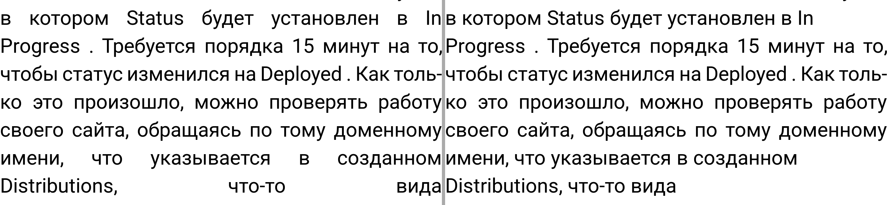
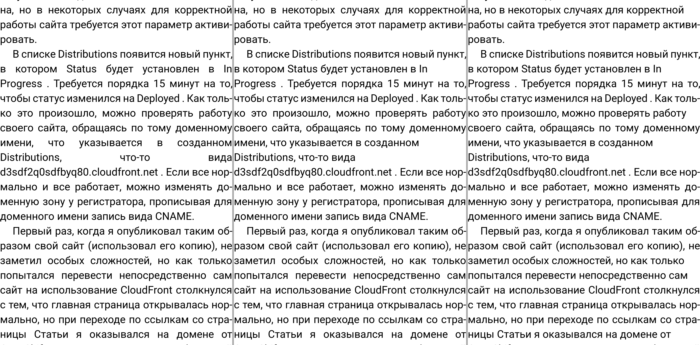
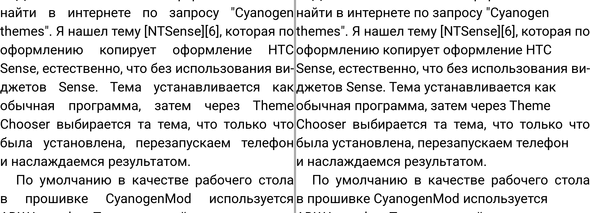

# Word gaps: a justified page today and with a ceiling on the word space

Date: 2026-10-31. Status: research; the app is unchanged, the ceiling exists only in the
desktop harness. Task: [issue #99](https://github.com/juev/perigee/issues/99).

The ceiling: a justified line whose gap — the font's own space plus its share of the
line's leftover width — would come out wider than the ceiling is left aligned instead,
with its natural spacing. Line breaks do not change, only the alignment of those lines.
Lines with a single gap are not touched; a rule about them is a separate decision.

## The setting

Roboto, 63 px (18 dp at 560 dpi), text width 1384 px, page height 2800 px, hyphenation
on, render DPI 560. That is 22 em, about 42 characters a line — a 1440 px phone with the
narrow 8 dp margins of the reader. The owner's screen width is not in the repository, so
this is the plausible case, not a measured one, and it matters: the same font at 28 px
over 1032 px (37 em, 70 characters) has four times fewer wide lines.

The book: 1800 paragraphs of the owner's prose, made into an FB2 of 600 KB. An earlier
run used blog posts whose text still carried URLs and HTML snippets; those pages were
pathological and are not representative, so they were dropped.

## Whole book

13293 justified lines.

| ceiling | ragged | p50 | p90 | p99 | widest | over 0.5 em | over 0.75 em |
| --- | --- | --- | --- | --- | --- | --- | --- |
| none (today) | — | 0.35 em | 0.60 | 1.13 | 5.48 em | 18.9 % | 4.4 % |
| 0.75 em | 585 (4.4 %) | 0.34 | 0.56 | 0.71 | — | 15.1 % | 0 |
| 0.5 em | 2659 (20.0 %) | 0.32 | 0.45 | 0.50 | — | 0 | 0 |

The ceiling moves the medians by a hundredth of an em and takes the tail away. What it
costs is the right edge of 4.4 % of lines at 0.75 em, and one line in five at 0.5 em.

## Three pages

| page | lines | widest today | 0.75 em: ragged, widest kept | 0.5 em: ragged, widest kept |
| --- | --- | --- | --- | --- |
| 291 | 23 | 5.48 em | 3, 0.71 em | 7, 0.45 em |
| 171 | 30 | 1.30 | 6, 0.69 | 10, 0.48 |
| 121 | 24 | 7.83 | 1, 7.83 | 3, 7.83 |

Page 121 is the case the ceiling cannot reach: its widest line has a single gap, and a
single-gap line has nowhere to put its excess — the engine already gives all of it to
that one space. Such a line comes from a long unbreakable token (a URL, a Latin name)
and would need the breaker, not a ceiling.

## Page 291, the clearest page

Today on the left, a 0.75 em ceiling on the right, the lines around the widest gap of
the book:



The three ceilings on the same page:



Left: `Distributions, что-то вида` is spread over the whole width, with gaps three to
five times a normal space. Middle: the line breaks nothing, it is simply set
left-aligned, and the hole is gone. Right: the 0.5 em ceiling changes nothing more here,
because the loose lines of this page were all past 0.75 em.

## Page 171, an ordinary page



Six of thirty lines lose their right edge, one of them in the middle of a justified
paragraph. That is the trade to judge: the 1.3 em gaps are gone and a few lines end
short. My own reading: at 0.75 em the page is better — it looks typeset rather than
broken — but six ragged lines out of thirty is close to the point where it starts to
look like a mistake, and at 0.5 em it passes that point.

## Page 121, what the ceiling does not fix

Page 121 holds both cases. Its four- and five-word lines lose their 6-8 em gaps like
anywhere else, but its widest line has a single gap and keeps it in every column: a
single-gap line has nowhere to put its excess, the engine already gives all of it to
that one space. Such a line comes from a long unbreakable token (a URL, a Latin name)
and needs the breaker, not a ceiling — hyphenate the token, or break the line before it.
There were two such lines in the whole book.

## Reproduce

```sh
BUILD=/some/dir engine/tools/desktop/build.sh
G=/some/dir/cmake/gaps F=engine/src/main/assets/crengine/fonts
$G --book BOOK.fb2 --font Roboto=$F/Roboto-Variable.ttf --face Roboto --size-px 63 \
    --width-px 1384 --height-px 2800 --render-dpi 560 --hyphenation on \
    --cap-em 0.75 --png pgm --pages 121,171,291 --out cap075.csv
python3 engine/tools/desktop/gaps-report.py cap075.csv
python3 engine/tools/desktop/gaps-report.py --by-page --over 0.75 0.5 cap075.csv
python3 engine/tools/desktop/pgm2png.py pgm/PAGE.pgm PAGE.png
```

The rows of a page that `--pages` draws are written twice, once in the sequential pass
and once for the image; the figures above drop the repeats by `node` and `y`.
