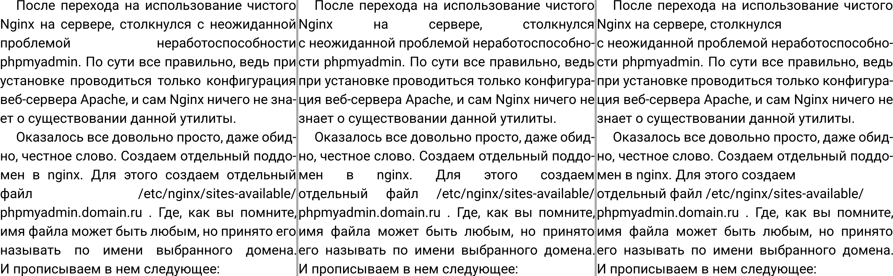
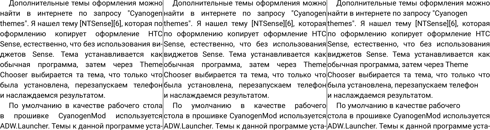
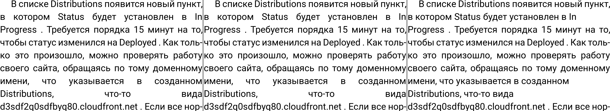

# Word gaps: a justified page today and with a ceiling on the word space

Date: 2026-10-31. Status: research; the app is unchanged, the ceiling exists only in the
desktop harness. Task: [issue #99](https://github.com/juev/perigee/issues/99).

The ceiling: a justified line whose gap — the font's own space plus its share of the
line's leftover width — would come out wider than the ceiling is left aligned instead,
with its natural spacing. Line breaks do not change, only the alignment of those lines.
Lines with a single gap are not touched; a rule about them is a separate decision.

## The setting

Roboto, 63 px (18 dp at 560 dpi), text width 1384 px, page height 2800 px, hyphenation
on, render DPI 560. That is 22 em, about 42 characters a line — a 1440 px phone with the
narrow 8 dp margins of the reader. The owner's screen width is not in the repository, so
this is the plausible case, not a measured one, and it matters: the same font at 28 px
over 1032 px (37 em, 70 characters) has four times fewer wide lines.

The book: 1800 paragraphs of the owner's prose, made into an FB2 of 600 KB. An earlier
run used blog posts whose text still carried URLs and HTML snippets; those pages were
pathological and are not representative, so they were dropped.

## Whole book

13293 justified lines.

| ceiling | ragged | p50 | p90 | p99 | widest | over 0.5 em | over 0.75 em |
| --- | --- | --- | --- | --- | --- | --- | --- |
| none (today) | — | 0.35 em | 0.60 | 1.13 | 5.48 em | 18.9 % | 4.4 % |
| 0.75 em | 585 (4.4 %) | 0.34 | 0.56 | 0.71 | — | 15.1 % | 0 |
| 0.5 em | 2659 (20.0 %) | 0.32 | 0.45 | 0.50 | — | 0 | 0 |

The ceiling moves the medians by a hundredth of an em and takes the tail away. What it
costs is the right edge of 4.4 % of lines at 0.75 em, and one line in five at 0.5 em.

## Three pages

| page | lines | widest today | 0.75 em: ragged, widest kept | 0.5 em: ragged, widest kept |
| --- | --- | --- | --- | --- |
| 291 | 23 | 5.48 em | 3, 0.71 em | 7, 0.45 em |
| 171 | 30 | 1.30 | 6, 0.69 | 10, 0.48 |
| 121 | 24 | 7.83 | 1, 7.83 | 3, 7.83 |

Page 121 is the case the ceiling cannot reach: its widest line has a single gap, and a
single-gap line has nowhere to put its excess — the engine already gives all of it to
that one space. Such a line comes from a long unbreakable token (a URL, a Latin name)
and would need the breaker, not a ceiling.

## Page 291, the clearest page

Today on the left, a 0.75 em ceiling on the right, the lines around the widest gap of
the book:


The three ceilings on the same page:


Left: `Distributions, что-то вида` is spread over the whole width, with gaps three to
five times a normal space. Middle: the line breaks nothing, it is simply set
left-aligned, and the hole is gone. Right: the 0.5 em ceiling changes nothing more here,
because the loose lines of this page were all past 0.75 em.

## Page 171, an ordinary page


Six of thirty lines lose their right edge, one of them in the middle of a justified
paragraph. That is the trade to judge: the 1.3 em gaps are gone and a few lines end
short. My own reading: at 0.75 em the page is better — it looks typeset rather than
broken — but six ragged lines out of thirty is close to the point where it starts to
look like a mistake, and at 0.5 em it passes that point.

## Page 121, what the ceiling does not fix

Page 121 holds both cases. Its four- and five-word lines lose their 6-8 em gaps like
anywhere else, but its widest line has a single gap and keeps it in every column: a
single-gap line has nowhere to put its excess, the engine already gives all of it to
that one space. Such a line comes from a long unbreakable token (a URL, a Latin name)
and needs the breaker, not a ceiling — hyphenate the token, or break the line before it.
There were two such lines in the whole book.

## Look one line ahead

The engine breaks greedily: each line takes as much text as fits, and the leftover goes into its
gaps. The lookahead variant (`gaps --lookahead on`, `PERIGEE_GAPS_LOOKAHEAD=1` in the hook) checks,
before a justified line is added, the gap of this line and the gap the next line would get. If
either is wider than the ceiling (`--cap-em`, 0.75 em without it), it tries the three wrap
opportunities before the greedy break, measures the pair for each, and keeps the break whose wider
gap of the two is the narrowest. A candidate must leave this line two gaps or more, and it may not
push the next line over the ceiling when the greedy break kept it under. A gain under a pixel is a
tie, and the greedy break stays. The lookahead never leaves a line ragged; that is the ceiling's
job. Paragraphs with images, inline boxes, floats, BiDi or CJK text stay greedy.

The trigger differs from the issue's wording. The issue asks to react when *this* line's gap is too
wide. An earlier break always loosens this line, so that trigger can never win; built that way it
moved 0 lines in the whole book. The wide line is usually the one after: it ends before a long word.
The fix is to break the line before it earlier, so the trigger looks at both lines.

The next line is measured by a short copy of the engine's own rule: the last wrap that fits with
the spaces condensed, then the hyphenation loop walking back word by word. Over the book this
estimate matched the line the engine then made in all 22 400 cases where both were greedy.

### Whole book

Same book and setting as above. `widest` and the shares count lines left justified; `over 0.75 em`
is the share of all justified lines.

| run | justified lines | break moved | ragged | p50 | p90 | p99 | widest | over 0.75 em | hyphenated | pages |
| --- | --- | --- | --- | --- | --- | --- | --- | --- | --- | --- |
| today | 13293 | 0 | 0 | 0.35 em | 0.60 | 1.13 | 5.48 em | 587 (4.4 %) | 44.3 % | 487 |
| lookahead | 13297 | 152 (1.1 %) | 0 | 0.36 | 0.61 | 1.04 | 5.48 | 545 (4.1 %) | 43.8 % | 488 |
| ceiling 0.75 em | 13293 | 0 | 587 (4.4 %) | 0.34 | 0.56 | 0.71 | 0.75 | 0 | 44.3 % | 487 |
| lookahead + ceiling 0.75 em | 13297 | 152 | 545 (4.1 %) | 0.35 | 0.56 | 0.71 | 0.75 | 0 | 43.8 % | 488 |

Lines over 1 em: 197 today, 155 with the lookahead. By paragraph: the widest gap got narrower in 134
of 1800 paragraphs and wider in none; 503 paragraphs have a gap over 0.75 em today, 454 with the
lookahead. Of the 152 moved breaks, 67 left both lines of the pair under 0.75 em. The two lines with
a single gap are gone: the line before each now breaks earlier and gives them a second gap.

Formatting time, two runs each, `Render()` (line breaking of the whole book) and drawing all pages
(formatting with justification plus rasterising):

| run | `Render()`, ms | drawing, ms |
| --- | --- | --- |
| today | 127, 128 | 1522, 1519 |
| lookahead | 147, 147 | 1596, 1554 |
| ceiling 0.75 em | 175, 127 | 1580, 1530 |
| lookahead + ceiling 0.75 em | 148, 157 | 1549, 1549 |

The lookahead adds about 20 ms, 15 %, to `Render()`; in drawing the difference is within the noise
between runs.

Text: the characters laid out are the same. A scratch build printed the text of every line formatted
in `Render()`; joined, it is 595 338 characters with the same SHA-256 today and with the lookahead,
in 15 096 and 15 098 lines. `getPageText()` per page could not settle it: it returns the text of the
page's DOM range, and at some page boundaries that range repeats a few words of the previous page,
which depends on where the pages break.

### Pages

Each strip: today, lookahead, lookahead + 0.75 em ceiling. The lookahead adds lines, so the same page
number starts one or two lines earlier; the panels are lined up on their identical lines, not on the
top of the page.



Page 121 is where the lookahead does most. `проблемой неработоспособности` and
`файл /etc/nginx/sites-available/`, a single gap of 6-8 em each, are gone: the lines before them
break a word earlier and they get a second word. The price is visible too: `Nginx на сервере,
столкнулся` and `мен в nginx. Для этого создаем` now carry the hole, smaller but still about 2-3 em.
The ceiling then sets those lines ragged.



Page 171 shows both outcomes. In the first paragraph `оформлению копирует оформление HTC` loses its
wide gaps when `по` moves down. In the second the hole only moves up a line: `По умолчанию в
качестве рабочего` is now the loose line instead of `в прошивке CyanogenMod используется`.



Page 291 does not change: the left and middle panels are identical. `Distributions, что-то вида`
sits before an unbreakable URL, and every earlier break makes the pair worse. The widest gap of the
book, 5.48 em, stays. Only the ceiling (right) removes it.

### Verdict

The lookahead is a small gain, not a fix. It moves 1.1 % of breaks, takes p99 from 1.13 to
1.04 em and lines over 0.75 em from 587 to 545, and makes no paragraph's widest gap worse. It nudges
the median up by 0.01 em because it spreads a hole over two lines. It does not touch the widest gap,
and on pages like 171 it often just moves the hole. With the ceiling on, it saves 42 ragged lines of
587. The cost is about 150 lines of C++ in `lvtextfm.cpp`, a copy of the engine's line rule that has
to stay in step with it, and 15 % on line breaking. What remains is the unbreakable token (URLs,
paths) that needs the breaker itself, and a real fix for the rest would look further than one line,
which is the Knuth-Plass direction rather than a patch to the greedy loop.

## Reproduce

```sh
BUILD=/some/dir engine/tools/desktop/build.sh
G=/some/dir/cmake/gaps F=engine/src/main/assets/crengine/fonts
$G --book BOOK.fb2 --font Roboto=$F/Roboto-Variable.ttf --face Roboto --size-px 63 \
    --width-px 1384 --height-px 2800 --render-dpi 560 --hyphenation on \
    --cap-em 0.75 --png pgm --pages 121,171,291 --out cap075.csv
$G ... --lookahead on --cap-em 0.75 --png pgm --pages 121,171,291 --out lookahead-cap075.csv
python3 engine/tools/desktop/gaps-report.py cap075.csv
python3 engine/tools/desktop/gaps-report.py --by-page --over 0.75 0.5 cap075.csv
python3 engine/tools/desktop/pgm2png.py pgm/PAGE.pgm PAGE.png
```

The rows of a page that `--pages` draws are written twice, once in the sequential pass
and once for the image; the figures above drop the repeats by `node` and `y`.
