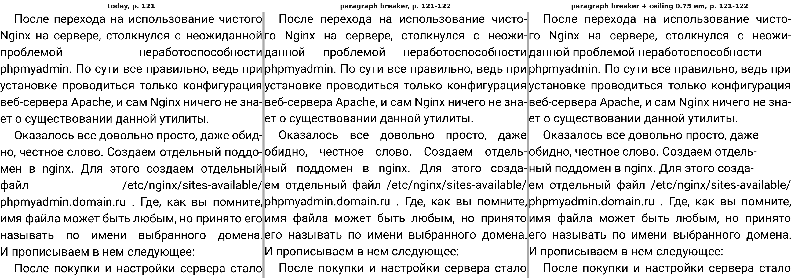
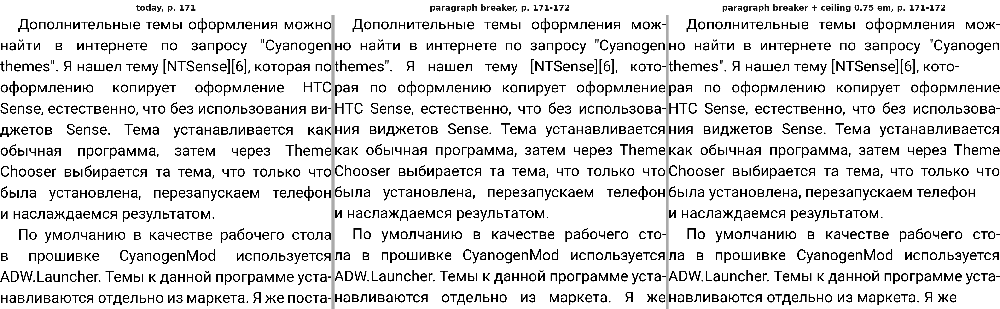
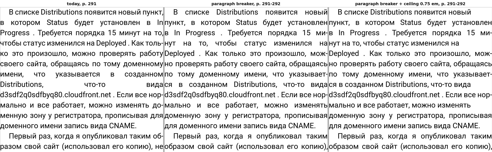

# Word gaps: a justified page today and with a ceiling on the word space

Date: 2026-10-31. Status: research; the app is unchanged, the ceiling exists only in the
desktop harness. Task: [issue #99](https://github.com/juev/perigee/issues/99).

The ceiling: a justified line whose gap — the font's own space plus its share of the
line's leftover width — would come out wider than the ceiling is left aligned instead,
with its natural spacing. Line breaks do not change, only the alignment of those lines.
Lines with a single gap are not touched; a rule about them is a separate decision.

## The setting

Roboto, 63 px (18 dp at 560 dpi), text width 1384 px, page height 2800 px, hyphenation
on, render DPI 560. That is 22 em, about 42 characters a line — a 1440 px phone with the
narrow 8 dp margins of the reader. The owner's screen width is not in the repository, so
this is the plausible case, not a measured one, and it matters: the same font at 28 px
over 1032 px (37 em, 70 characters) has four times fewer wide lines.

The book: 1800 paragraphs of the owner's prose, made into an FB2 of 600 KB. An earlier
run used blog posts whose text still carried URLs and HTML snippets; those pages were
pathological and are not representative, so they were dropped.

## Whole book

13293 justified lines.

| ceiling | ragged | p50 | p90 | p99 | widest | over 0.5 em | over 0.75 em |
| --- | --- | --- | --- | --- | --- | --- | --- |
| none (today) | — | 0.35 em | 0.60 | 1.13 | 5.48 em | 18.9 % | 4.4 % |
| 0.75 em | 585 (4.4 %) | 0.34 | 0.56 | 0.71 | — | 15.1 % | 0 |
| 0.5 em | 2659 (20.0 %) | 0.32 | 0.45 | 0.50 | — | 0 | 0 |

The ceiling moves the medians by a hundredth of an em and takes the tail away. What it
costs is the right edge of 4.4 % of lines at 0.75 em, and one line in five at 0.5 em.

## Three pages

| page | lines | widest today | 0.75 em: ragged, widest kept | 0.5 em: ragged, widest kept |
| --- | --- | --- | --- | --- |
| 291 | 23 | 5.48 em | 3, 0.71 em | 7, 0.45 em |
| 171 | 30 | 1.30 | 6, 0.69 | 10, 0.48 |
| 121 | 24 | 7.83 | 1, 7.83 | 3, 7.83 |

Page 121 is the case the ceiling cannot reach: its widest line has a single gap, and a
single-gap line has nowhere to put its excess — the engine already gives all of it to
that one space. Such a line comes from a long unbreakable token (a URL, a Latin name)
and would need the breaker, not a ceiling.

## Page 291, the clearest page

Today on the left, a 0.75 em ceiling on the right, the lines around the widest gap of
the book:


The three ceilings on the same page:


Left: `Distributions, что-то вида` is spread over the whole width, with gaps three to
five times a normal space. Middle: the line breaks nothing, it is simply set
left-aligned, and the hole is gone. Right: the 0.5 em ceiling changes nothing more here,
because the loose lines of this page were all past 0.75 em.

## Page 171, an ordinary page


Six of thirty lines lose their right edge, one of them in the middle of a justified
paragraph. That is the trade to judge: the 1.3 em gaps are gone and a few lines end
short. My own reading: at 0.75 em the page is better — it looks typeset rather than
broken — but six ragged lines out of thirty is close to the point where it starts to
look like a mistake, and at 0.5 em it passes that point.

## Page 121, what the ceiling does not fix

Page 121 holds both cases. Its four- and five-word lines lose their 6-8 em gaps like
anywhere else, but its widest line has a single gap and keeps it in every column: a
single-gap line has nowhere to put its excess, the engine already gives all of it to
that one space. Such a line comes from a long unbreakable token (a URL, a Latin name)
and needs the breaker, not a ceiling — hyphenate the token, or break the line before it.
There were two such lines in the whole book.

## Look one line ahead

The engine breaks greedily: each line takes as much text as fits, and the leftover goes into its
gaps. The lookahead variant (`gaps --lookahead on`, `PERIGEE_GAPS_LOOKAHEAD=1` in the hook) checks,
before a justified line is added, the gap of this line and the gap the next line would get. If
either is wider than the ceiling (`--cap-em`, 0.75 em without it), it tries the three wrap
opportunities before the greedy break, measures the pair for each, and keeps the break whose wider
gap of the two is the narrowest. A candidate must leave this line two gaps or more, and it may not
push the next line over the ceiling when the greedy break kept it under. A gain under a pixel is a
tie, and the greedy break stays. The lookahead never leaves a line ragged; that is the ceiling's
job. Paragraphs with images, inline boxes, floats, BiDi or CJK text stay greedy.

The trigger differs from the issue's wording. The issue asks to react when *this* line's gap is too
wide. An earlier break always loosens this line, so that trigger can never win; built that way it
moved 0 lines in the whole book. The wide line is usually the one after: it ends before a long word.
The fix is to break the line before it earlier, so the trigger looks at both lines.

The next line is measured by a short copy of the engine's own rule: the last wrap that fits with
the spaces condensed, then the hyphenation loop walking back word by word. Over the book this
estimate matched the line the engine then made in all 22 400 cases where both were greedy.

### Whole book

Same book and setting as above. `widest` and the shares count lines left justified; `over 0.75 em`
is the share of all justified lines.

| run | justified lines | break moved | ragged | p50 | p90 | p99 | widest | over 0.75 em | hyphenated | pages |
| --- | --- | --- | --- | --- | --- | --- | --- | --- | --- | --- |
| today | 13293 | 0 | 0 | 0.35 em | 0.60 | 1.13 | 5.48 em | 587 (4.4 %) | 44.3 % | 487 |
| lookahead | 13297 | 152 (1.1 %) | 0 | 0.36 | 0.61 | 1.04 | 5.48 | 545 (4.1 %) | 43.8 % | 488 |
| ceiling 0.75 em | 13293 | 0 | 587 (4.4 %) | 0.34 | 0.56 | 0.71 | 0.75 | 0 | 44.3 % | 487 |
| lookahead + ceiling 0.75 em | 13297 | 152 | 545 (4.1 %) | 0.35 | 0.56 | 0.71 | 0.75 | 0 | 43.8 % | 488 |

Lines over 1 em: 197 today, 155 with the lookahead. By paragraph: the widest gap got narrower in 134
of 1800 paragraphs and wider in none; 503 paragraphs have a gap over 0.75 em today, 454 with the
lookahead. Of the 152 moved breaks, 67 left both lines of the pair under 0.75 em. The two lines with
a single gap are gone: the line before each now breaks earlier and gives them a second gap.

Formatting time, two runs each, `Render()` (line breaking of the whole book) and drawing all pages
(formatting with justification plus rasterising):

| run | `Render()`, ms | drawing, ms |
| --- | --- | --- |
| today | 127, 128 | 1522, 1519 |
| lookahead | 147, 147 | 1596, 1554 |
| ceiling 0.75 em | 175, 127 | 1580, 1530 |
| lookahead + ceiling 0.75 em | 148, 157 | 1549, 1549 |

The lookahead adds about 20 ms, 15 %, to `Render()`; in drawing the difference is within the noise
between runs.

Text: the characters laid out are the same. A scratch build printed the text of every line formatted
in `Render()`; joined, it is 595 338 characters with the same SHA-256 today and with the lookahead,
in 15 096 and 15 098 lines. `getPageText()` per page could not settle it: it returns the text of the
page's DOM range, and at some page boundaries that range repeats a few words of the previous page,
which depends on where the pages break.

### Pages

Each strip: today, lookahead, lookahead + 0.75 em ceiling. The lookahead adds lines, so the same page
number starts one or two lines earlier; the panels are lined up on their identical lines, not on the
top of the page.


Page 121 is where the lookahead does most. `проблемой неработоспособности` and
`файл /etc/nginx/sites-available/`, a single gap of 6-8 em each, are gone: the lines before them
break a word earlier and they get a second word. The price is visible too: `Nginx на сервере,
столкнулся` and `мен в nginx. Для этого создаем` now carry the hole, smaller but still about 2-3 em.
The ceiling then sets those lines ragged.


Page 171 shows both outcomes. In the first paragraph `оформлению копирует оформление HTC` loses its
wide gaps when `по` moves down. In the second the hole only moves up a line: `По умолчанию в
качестве рабочего` is now the loose line instead of `в прошивке CyanogenMod используется`.


Page 291 does not change: the left and middle panels are identical. `Distributions, что-то вида`
sits before an unbreakable URL, and every earlier break makes the pair worse. The widest gap of the
book, 5.48 em, stays. Only the ceiling (right) removes it.

### Verdict

The lookahead is a small gain, not a fix. It moves 1.1 % of breaks, takes p99 from 1.13 to
1.04 em and lines over 0.75 em from 587 to 545, and makes no paragraph's widest gap worse. It nudges
the median up by 0.01 em because it spreads a hole over two lines. It does not touch the widest gap,
and on pages like 171 it often just moves the hole. With the ceiling on, it saves 42 ragged lines of
587. The cost is about 150 lines of C++ in `lvtextfm.cpp`, a copy of the engine's line rule that has
to stay in step with it, and 15 % on line breaking. What remains is the unbreakable token (URLs,
paths) that needs the breaker itself, and a real fix for the rest would look further than one line,
which is the Knuth-Plass direction rather than a patch to the greedy loop.

## Break the paragraph as a whole

The paragraph breaker (`gaps --paragraph on`, `PERIGEE_GAPS_PARAGRAPH=1` in the hook) chooses all the
breaks of a justified paragraph at once, by the lowest total badness of its lines, the way TeX does,
instead of filling one line after another. Unset, the engine runs as before: the run without it gives
the CSV of the build before the change byte for byte in its first 14 columns, and 0 in the two new
ones, `paragraph` and `cost`.

### What it does

Before the line loop of `processParagraph()` starts, `perigeePlanParagraph()` lists the candidates:
every wrap the greedy loop may take, and every point `hyphenate()` finds in the words the greedy loop
would hyphenate, with the same dictionary, the same minimum letters before and after the hyphen and
the same rule that a line keeps at least two characters before a hyphen. A line from one candidate to
the next is measured from the cumulative widths `m_widths` alone, without shaping: natural width, plus
the hyphen; gaps; stretch, half of each gap's space; shrink, what the 75 % condensing floor lets each
gap lose, counted as the greedy loop counts it. The line fits when its natural width is at most the
width plus its shrink. Its badness is `min(10000, 100 |r|^3)`, `r` the leftover over the stretch when
it must stretch and the excess over the shrink when it must shrink. A line ending in a hyphen adds 50
(`PERIGEE_GAPS_HYPHEN_PENALTY`), and 10000 more when the line before also ended in one; the last line
costs nothing. The first pass takes only lines with `r` at most `PERIGEE_GAPS_TOLERANCE / 100` (300,
so a line may stretch to three times its stretch, a gap of 2.5 spaces, 0.63 em). When no path stays
within that, a second pass takes every line that fits. Dynamic programming over the candidates keeps
the cheapest path to each; a start drops out of the active set once a line from it overflows without
a hyphen, since every later line from it would too. There is no window or beam.

Three choices are mine and differ from the issue's wording:

- **Tolerance.** The issue writes the fitting range as `[width - shrink, width + stretch * tolerance]`.
  Read literally, with 300, that is three hundred times the stretch, so I read it as a percentage of
  the stretch. TeX's meaning, a limit on badness (300 is `r` up to 1.44), sends 85 % of paragraphs to
  the second pass: 3080 of 3602 plans in a run of the whole book, `Render()` and drawing together.
- **The second pass keeps badness above 10000.** The issue does not say what to do when nothing fits
  the tolerance. With the ceiling of 10000 every line past it costs the same, and the pass puts the
  paragraph's whole hole into one line: in a scratch build the widest gap went to 8.44 em and p99 to
  1.83 em. Leaving such paragraphs greedy kept p99 at 1.00 em and the widest at 5.48. Without the
  ceiling the widest is 2.75 em.
- **No 5 % rule.** The greedy loop hyphenates only when a plain wrap would leave more than 5 % of the
  line unused. The breaker offers every hyphenation point and lets the penalty decide.

The chosen breaks go through the existing line loop. It runs unchanged: it scans the line, finds its
greedy wrap and hyphenates as before. Then, right where it has settled `wrapPos`,
`perigeeTakePlannedBreak()` puts in the planned break and moves the hyphenation flag to it. Word
collection, hyphen drawing, positions, xpointers and drawing are those of a greedy line. The loop also
checks the plan: a planned break past the furthest wrap the loop found to fit, or before the line's
start, drops the plan and leaves the rest of the paragraph greedy. Over the book that happened 0 times.
Paragraphs with images, inline boxes, floats, BiDi, CJK, initial letters or `::first-line` stay
greedy. Ligatures, kerning and shaping are not touched.

Text: the characters laid out are the same. A scratch build printed the words of every line `addLine()`
made in `Render()`, each from its source text fragment. Joined without separators, today gives 595 338
characters in 15 096 lines; the breaker and the breaker with the 0.75 em ceiling give 15 132 lines with
the same 595 338 characters and the same SHA-256 (`43dce9d972566259…`). The number of words differs,
90 694 against 90 339, because a hyphenated word counts as two.

### Whole book

Same book and setting. `widest` and the gap percentiles count lines left justified. The shares over
0.5 and 0.75 em are shares of all justified lines with two gaps or more, a ragged line not counted as
over. Over 0.5 em here means over 0.5 em: the 18.9 % in the first table above is the share over twice
the space, 0.508 em.

| run | justified lines | ragged | p50 | p90 | p99 | widest | over 0.5 em | over 0.75 em | hyphenated | pages |
| --- | --- | --- | --- | --- | --- | --- | --- | --- | --- | --- |
| today | 13293 | 0 | 0.35 em | 0.60 | 1.13 | 5.48 em | 20.0 % | 4.4 % | 44.3 % | 487 |
| ceiling 0.75 em | 13293 | 587 (4.4 %) | 0.34 | 0.56 | 0.71 | 0.75 | 15.6 % | 0 | 44.3 % | 487 |
| paragraph | 13331 | 0 | 0.39 | 0.59 | 0.85 | 2.75 | 23.9 % | 2.2 % | 41.4 % | 489 |
| paragraph + ceiling 0.75 em | 13331 | 299 (2.2 %) | 0.38 | 0.58 | 0.70 | 0.75 | 21.7 % | 0 | 41.4 % | 489 |
| paragraph, tolerance 150 | 13341 | 0 | 0.39 | 0.63 | 0.88 | 2.75 | 26.7 % | 3.5 % | 38.1 % | 489 |
| paragraph, tolerance 600 | 13373 | 0 | 0.40 | 0.65 | 0.95 | 2.75 | 29.7 % | 4.4 % | 35.1 % | 490 |

Lines over 1 em: 197 today, 46 with the breaker, 48 at tolerance 150, 64 at 600. By paragraph,
against today: the widest gap is narrower by more than a pixel in 669 paragraphs and wider in 235; 15
paragraphs get a gap over 0.75 em they did not have. 503 paragraphs have a gap over 0.75 em today, 231
with the breaker. The two single-gap lines of the book are gone. The widest line left, 2.75 em on page
398, is `И теперь остается изменить` before the path `.openshift/config.mysql.yml`: no break before the
unbreakable token does better. The breaker condenses less than the greedy loop (2003 condensed lines
against 2533), and its lines are shorter on average: 38 justified lines and two pages more.

Tolerance 150 sends 1490 of 1802 paragraphs to the second pass. Tolerance 600 lets many lines stretch
further and hyphenates less: the median and p90 rise and lines over 0.75 em come back to today's 4.4 %.
300 is the best of the three on every gap figure.

### What a paragraph costs

From the log of `--paragraph-log`, the 1802 paragraphs planned in `Render()`:

| tolerance | first pass | second pass | cost p50 | p90 | p99 | max |
| --- | --- | --- | --- | --- | --- | --- |
| 300 | 1386 | 416 | 10334 / 15668 | 29714 / 36957 | 54036 / 188156 | 85573 / 756746 |
| 150 | 312 | 1490 | 10779 / 8979 | 40318 / 24448 | 51100 / 73905 | 70726 / 756746 |
| 600 | 1764 | 38 | 7812 / 69339 | 20235 / 199046 | 34033 / 689118 | 55116 / 756746 |

Each cell gives the first pass, then the second. Only one paragraph costs 0. Most costs sit just above
10000 because of the double-hyphen term: within the tolerance there is often no path without two
hyphenated lines in a row. 806 of 1800 paragraphs keep such a pair, against 1145 today.

Time, four rounds of the six runs, the runs of a round one after another, each round started when
the one-minute load average of the machine was under 2. Runs made while other builds loaded it gave
`Render()` from 130 to 970 ms for the same setting and are left out.

| run | `Render()`, ms | drawing, ms |
| --- | --- | --- |
| today | 131, 151, 132, 127 | 1524, 1534, 1532, 1552 |
| ceiling 0.75 em | 132, 128, 132, 133 | 1574, 1577, 1683, 1558 |
| paragraph | 222, 208, 266, 206 | 1671, 1710, 1800, 1688 |
| paragraph + ceiling 0.75 em | 202, 200, 200, 210 | 1640, 1637, 1666, 1629 |
| paragraph, tolerance 150 | 222, 231, 226, 232 | 1675, 1721, 1677, 1681 |
| paragraph, tolerance 600 | 203, 204, 238, 201 | 1654, 1673, 1654, 1644 |

The breaker adds about 80 ms, 60 %, to `Render()` (medians 131 and 215 ms), and about 160 ms, 10 %, to
drawing all pages, which formats each page's paragraphs again. The log puts the pass itself at 67 ms
in `Render()`, and 40 ms of that is hyphenation: the breaker hyphenates every word of four letters or more, where the greedy
loop hyphenates about one word a line. The rest, 27 ms, is the dynamic programming over 847 000 lines
tried, about 100 candidates and 470 lines a paragraph. No paragraph stands out: the 50 paragraphs with
200 to 399 candidates take 4.5 ms in all, and none has 400. At tolerance 150 the second pass runs for
1490 paragraphs and the pass takes 90 ms. Over the book concatenated three times (1461 pages today,
1467 with the breaker) `Render()` takes 410, 392, 393, 394 ms today and 631, 609,
612, 631 with the breaker; drawing 5174, 5091, 5151, 5213 against 5467, 5524, 5517, 5510. The share
stays the same on the bigger book: 55 to 60 % on `Render()`, 7 % on drawing.

### Pages

Each strip: today, the breaker, the breaker with the 0.75 em ceiling. The breaker moves text between
pages, so the panels are lined up on the start of the same paragraph. In the middle and right panels
that paragraph starts at the foot of the named page and runs onto the next. The strip joins the two
pages at the line pitch, without the white rows at the foot of the first.



Page 121 is mixed. `файл /etc/nginx/sites-available/` is gone: `ем отдельный файл` now comes before the
path. The single-gap `проблемой неработоспособности` becomes `данной проблемой неработоспособности`, two
gaps and still a visible hole. The next paragraph pays for the fix: `Оказалось все довольно просто,
даже`, `обидно, честное слово. Создаем отдель-` and `ный поддомен в nginx` are all loose; today the
paragraph had the hole of the `файл` line and one loose line, `называть по имени выбранного домена.`
With the ceiling those three lines go ragged.



Page 171 is close to a wash. `оформлению копирует оформление HTC` and `в прошивке CyanogenMod
используется` lose their wide gaps. `themes". Я нашел тему [NTSense][6], кото-` and `навливаются
отдельно из маркета. Я же` take them instead.



Page 291 is where the eye can tell at once. The 5.48 em hole of `Distributions, что-то вида` is gone:
`ся в созданном Distributions, что-то вида` is only somewhat loose. The rest of the hole is spread
over the paragraph: its first line, `нут на то, чтобы статус изменился на` and `мально и все работает,
можно изменять` are visibly loose. With the ceiling these four lines of the paragraph go ragged.

### Verdict

The paragraph breaker does what greedy breaking cannot: it removes the worst holes without leaving
lines ragged. p99 falls from 1.13 to 0.85 em, the widest gap from 5.48 to 2.75, lines over 1 em from
197 to 46 and lines over 0.75 em by half. It does not beat the ceiling. The 0.75 em ceiling alone gives
p90 0.56 and p99 0.71 and no gap over 0.75 em, where the breaker leaves 2.2 % of lines over it. And
the breaker loosens ordinary lines: the median rises from 0.35 to 0.39 em and lines over 0.5 em from
20.0 to 23.9 %. It spreads a hole over several lines rather than removing it, and the eye sees several
loose lines where it saw one bad one. That trade is clearly good on page 291, a wash on 171 and mixed
on 121. With the ceiling on, the breaker halves the ragged lines, 299 against 587, at a similar tail
(p99 0.70) but a looser body (over 0.5 em 21.7 % against 15.6 %).

The cost: about 300 lines in `lvtextfm.cpp` with comments, 60 % on line breaking in `Render()`
and 10 % on drawing, and two pages more over the book. The line loop is reused, not rewritten, so the plan stays honest about what the engine can
lay out; the price is that hyphenation runs twice. The cost function as given has no penalty per line
and leaves the last line free, so nothing stops it from adding lines and stretching them. Whether
TeX's squared demerits with a line penalty would keep the median down is a guess I have not measured.
As it stands, the ceiling is the cheaper fix for the tail, and the breaker is worth keeping only as a
way to make the ceiling leave fewer lines ragged.

## Reproduce

```sh
BUILD=/some/dir engine/tools/desktop/build.sh
G=/some/dir/cmake/gaps F=engine/src/main/assets/crengine/fonts
$G --book BOOK.fb2 --font Roboto=$F/Roboto-Variable.ttf --face Roboto --size-px 63 \
    --width-px 1384 --height-px 2800 --render-dpi 560 --hyphenation on \
    --cap-em 0.75 --png pgm --pages 121,171,291 --out cap075.csv
$G ... --lookahead on --cap-em 0.75 --png pgm --pages 121,171,291 --out lookahead-cap075.csv
$G ... --paragraph on --paragraph-log paragraph.log --png pgm --pages 121,122 --out paragraph.csv
$G ... --paragraph on --tolerance 150 --out paragraph-tol150.csv
python3 engine/tools/desktop/gaps-report.py --costs paragraph.log
python3 engine/tools/desktop/gaps-report.py cap075.csv
python3 engine/tools/desktop/gaps-report.py --by-page --over 0.75 0.5 cap075.csv
python3 engine/tools/desktop/pgm2png.py pgm/PAGE.pgm PAGE.png
```

The rows of a page that `--pages` draws are written twice, once in the sequential pass
and once for the image; the figures above drop the repeats by `node` and `y`.
